<picture>
  <source media="(max-width: 767px)" srcset="./assets/banner-mobile.svg" />
  
</picture>

<a href="https://athoi-moni-saha.vercel.app">
  <picture>
    <source media="(max-width: 767px)" srcset="https://readme-typing-svg.demolab.com?font=JetBrains+Mono&weight=600&size=15&duration=2600&pause=900&color=F472B6&center=true&vCenter=true&width=300&height=36&lines=Full-stack+developer;Python+%2B+JavaScript;Backend+%C2%B7+AI+%C2%B7+IoT;Building+Kaloria+AI;Open+to+internships" />
    
  </picture>
</a>

  
  
  

  
  
  

<picture>
  <source media="(max-width: 767px) and (prefers-color-scheme: light)" srcset="./assets/terminal-mobile-light.svg" />
  <source media="(max-width: 767px)" srcset="./assets/terminal-mobile-dark.svg" />
  <source media="(prefers-color-scheme: light)" srcset="./assets/terminal-light.svg" />
  
</picture>

## 🌸 Hi, I'm Athoi

I'm **Athoi Moni Saha**, a **full-stack developer** and Computer Science & Engineering student at **Chandigarh University**, India.

I build web apps with **Python**, **JavaScript** and **Node.js**, and I'm especially curious about **backend systems, AI and IoT**.

- 🍎 Building **[Kaloria AI](https://kaloria-ai.vercel.app)**, a gamified health tracker with an AI food scanner
- 📬 Built a **[lead distribution system](https://github.com/Athoi123/lead-distribution-system)** with fair round-robin allocation and atomic concurrency handling
- 🌱 Currently learning backend development, API design, machine learning, data structures and algorithms
- 🤝 Open to **internships** and **collaborations**

## ✨ Featured projects

### 🍎 [Kaloria AI](https://github.com/Athoi123/KALORIA_AI)

**Gamified health engine.** A glassmorphism dashboard with a Gemini-powered food photo scanner, an AI diet coach, personalised modes (general health, pregnancy, diabetic care, child growth) and an XP tracker with streaks. Nutrition data comes from the USDA API.

   

**[Live app →](https://kaloria-ai.vercel.app)**

### 📬 [Lead Distribution System](https://github.com/Athoi123/lead-distribution-system)

**Fair, concurrency-safe lead allocation.** Strict business rules, round-robin assignment, atomic updates so two requests never claim the same lead, and live provider dashboards.

   

**[Live demo →](https://lead-distribution-system-dusky.vercel.app)**

### 💬 [Social Media App](https://github.com/Athoi123/Social-media-app)

**Full-stack social network.** Registration and login with JWT and bcrypt, posts with comments and likes, editable profiles with photo upload, in a polished glassmorphism UI.

   

**[Live demo →](https://social-media-app-delta-lac.vercel.app)**

### 🎀 [Portfolio website](https://github.com/Athoi123/ATHOI-MONI-SAHA)

My personal portfolio, live at **[athoi-moni-saha.vercel.app](https://athoi-moni-saha.vercel.app)**.

<b>More projects</b>

 

- 🌾 **Crop Recommendation Using Machine Learning**: research project that predicts suitable crops from soil and environmental data
- 🌳 **Bonsai**: gamified Pomodoro productivity app with backend session tracking
- 🌱 **IoT Soil Monitoring System**: smart agriculture with sensors and an ESP32 for real-time soil monitoring

## 🛠️ Tech stack

  

**Languages:** Python, JavaScript, TypeScript, C++, C, SQL 
**Frontend:** React, Next.js, HTML, CSS, Tailwind CSS 
**Backend:** Node.js, Express, FastAPI, REST APIs 
**Data:** MongoDB, MySQL 
**Hardware and tools:** Arduino, ESP32, Git, GitHub, Vercel, VS Code

## 🎓 Education

**Computer Science & Engineering student**, Chandigarh University, India

## 📈 GitHub activity

  

  

  <picture>
    <source media="(prefers-color-scheme: dark)" srcset="https://raw.githubusercontent.com/Athoi123/Athoi123/output/snake-dark.svg" />
    <source media="(prefers-color-scheme: light)" srcset="https://raw.githubusercontent.com/Athoi123/Athoi123/output/snake-light.svg" />
    
  </picture>

## ❓ Quick answers

<b>Who is Athoi Moni Saha (Athoi123)?</b>

 
Athoi Moni Saha is a full-stack developer and Computer Science & Engineering student at Chandigarh University, India. On GitHub she is Athoi123.

<b>What does Athoi build?</b>

 
Full-stack web apps. Her projects include Kaloria AI (a gamified health tracker with an AI food scanner), a concurrency-safe lead distribution system, and a full-stack social media app.

<b>What tech stack does Athoi use?</b>

 
Python, JavaScript and TypeScript, with React and Next.js on the frontend, Node.js and FastAPI on the backend, MongoDB and MySQL for data, and Vercel for deployment. She also works with Arduino and ESP32 for IoT.

<b>Is Athoi available for internships?</b>

 
Yes. She is open to internships and collaborative projects.

<b>How do I contact Athoi?</b>

 
Through <a href="https://www.linkedin.com/in/athoi-saha-6061a1348/">LinkedIn</a>, or see her <a href="https://athoi-moni-saha.vercel.app">portfolio</a>.

### Let's build something together 🌸

[LinkedIn](https://www.linkedin.com/in/athoi-saha-6061a1348/) · [Portfolio](https://athoi-moni-saha.vercel.app) · [Kaloria AI](https://kaloria-ai.vercel.app)

